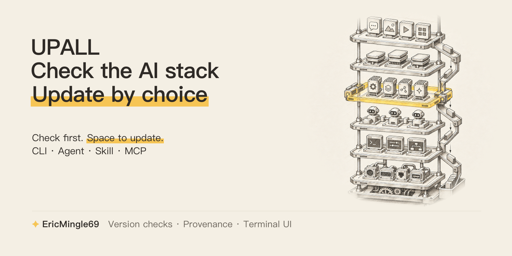
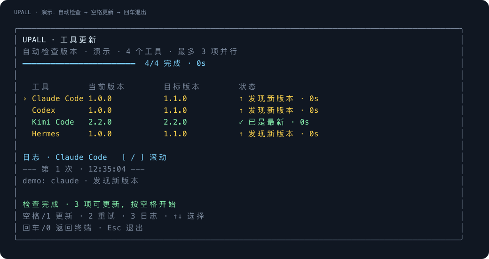

<picture>
  <source media="(prefers-color-scheme: dark)" srcset="readme-assets/cover-en-dark.png">
  
</picture>

<a href="docs/adapters.md">Adapters</a> · <a href="docs/development.md">Development</a> · <a href="CONTRIBUTING.md">Contributing</a> · <a href="https://github.com/Ming-Sir-69">Author</a>

<a href="README.md">简体中文</a> · <b>English</b>

# UPALL · AI toolchain checks and explicit updates

The project discovers installed AI CLIs, Agent tools and maintenance applications, checks versions, and updates supported installations only after an explicit action. When monitoring is enabled, the main list shows MCP and Skill installations across hosts. The Chinese-first terminal UI uses Python's standard library at runtime.

## Features

- Check automatically; Space/1 updates available items, Enter/0 exits.
- Preserve detected installation sources and package-manager prefixes; missing tools stay missing.
- Show per-tool logs, support narrow terminals and full-width keys.
- MCP only compares npx cache versions with the latest versions in the npm registry; it does not install packages or change configuration.
- Skills are identified by fingerprints. Only copied Kimi WebBridge Skills can be aligned after confirmation: by pressing Space on a row reporting inconsistent copies across hosts, or after a successful WebBridge upgrade. Symlinks remain unchanged; other Skills are only identified and displayed.

## Quick start

Requires Python 3.11+. Run directly from a checkout without installing:

~~~sh
git clone https://github.com/Ming-Sir-69/upall.git
cd upall
python3 tools/upall --demo
~~~

Install an isolated command using uv.[[2]](#references)

~~~sh
uv tool install git+https://github.com/Ming-Sir-69/upall.git
upall
~~~

To update UPALL itself, run `uv tool upgrade upall-cli`; to remove the commands, run `uv tool uninstall upall-cli`. UPALL does not update itself in the tool dashboard.

## Usage

| Key | Action |
|---|---|
| Space / 1 / U | Update tools with an available update |
| Enter / 0 / Esc / Q / X | Exit after the current batch finishes (from settings, return to the main view first) |
| 2 / R | Retry failures; refresh all checks, including MCP/Skill, when none failed |
| 3 / L | Toggle the selected tool's log |
| 4 / S | Open settings: toggle monitor kinds; changes rebuild the main list and recheck immediately |
| Up / Down, J / K, Tab | Select a tool (or a monitor kind in settings) |
| [ / ] | Scroll the log |
| Ctrl-C | Stop this batch and its child process groups |

Full-width ０１２３４ and the full-width space are supported. Update keys pressed during a running batch are not queued. Number-key hints keep the same mapping after completion. An IME may consume a key while composing text or selecting a candidate. PTY tests validate the input that reaches the terminal, not every IME.

Commands and reports

~~~sh
upall                 # Discover installed CLIs and check; wait for Space
upall claude codex    # Limit the batch to these tools
upall agent           # Only one group: cli, agent, app or host (also -g)
upall --list          # Local inventory, including missing tools; no network requests
upall --all           # Include missing candidates; skip, never install them
upall --json          # Final report; check only and exit
upall --plain         # Plain output; check only and exit
upall --retry         # Recheck failures from the previous batch
upall --update        # Explicitly check AND update, for unattended use
upall --demo          # Simulated UI; no real updater is invoked
~~~

The `upcheck` command is a compatibility alias for the same check-first flow. Redirected output, `TERM=dumb`, JSON and plain mode finish without waiting for a key. A failed update or check returns exit code 1; interrupted batches return 130; invocation/state errors return 2.

Use `upall --monitor runtime,skill,mcp` to filter monitor kinds, independently of display groups. Defaults enable runtime, Skill and MCP; plugin is disabled. Settings persist in `~/.config/upall/monitors.json`. See [vertical layers](docs/ai-vertical-layers.md).

## Design

The known catalog includes AI coding tools (AI 编程工具): Claude Code, Codex, Kimi Code, Hermes, Gemini CLI, Grok Build, OpenCode, OpenClaw, Pi, MiniMax Code and Cursor Agent; Agent plugins and skills (Agent 插件与技能): KimiCU, Kimi WebBridge, iPhone Use and Agent Desktop; Productivity and maintenance (效率与维护): Mole and CC Switch. Self-maintained projects can be added as host-defined tools; UPALL reports which local modifications upstream has absorbed; see [local modifications](docs/local-modifications.md).

- npm and Homebrew installations use the detected package and manager prefix. A command under a Homebrew bin directory can still belong to npm. npm operations try direct networking before the inherited proxy environment.
- Large downloads use aria2c with eight connections when installed, then a clean curl fallback. Native Claude Code updates keep the detected channel and target version, use the vendor's manifest and optional zstd package, and verify checksums before installation.
- Known native/script installations use the corresponding official updater or installer.
- Unknown or project-local installations require manual handling.
- Installation success is followed by a fresh version check.
- Checks run concurrently, with at most four workers; child processes are managed through Python subprocess.[[1]](#references) Installs sharing an npm prefix or Homebrew are serialized.

See [the support matrix](docs/adapters.md) for adapter boundaries. Tests use fake tools; a fixture passing does not prove every real installation variant works.

State defaults to `$XDG_STATE_HOME/upall`, or `~/.local/state/upall`, following the XDG state-directory convention.[[3]](#references) UPALL uses owner-only directories. Updates/checks use `latest/`, inventories use `inventory/`, and demonstrations use `demo/latest/`. Inventory does not replace the previous update report. Every run is also appended to `history.jsonl`. Each job's network records include route, downloader, attempt, elapsed time, bytes, throughput and failure reason.

`UPALL_LOG_ROOT` overrides the state root. `UPALL_SEARCH_PATH` limits discovery to an explicit search path for isolated tests. `NO_COLOR` disables color. The tool does not read API keys, sign-in stores, or conversation history. Reports and logs contain local paths and tool output; redact them before sharing.

Official updates execute third-party software, and an npm update may execute that package's lifecycle scripts. These commands run only after Space/1 or an explicit `--update`. Review the installation source. Run updates under the owner's own account; UPALL never adds sudo.

This repository owns the reusable implementation; consuming projects own configuration, shortcuts, private records and pinned revisions. See [module integration](docs/module-integration.md) and [standards and official practice](docs/standards.md).

## Limitations

Version 0.x is an early macOS release. The UI and integration tests run on macOS; other POSIX environments are experimental. Native Windows is not supported. There are no claims of universal package-manager support.

Pressing Space on an outdated MCP item only prompts for manual handling; it does not install packages or rewrite pinned host configurations. General plugin adapters remain a placeholder. The terminal demo uses simulated data; fixture tests do not establish compatibility with every real installation.

## Development

~~~sh
python3 -m venv .venv
.venv/bin/python -m pip install -e .
.venv/bin/python -m unittest discover -s tests -v
~~~

[Architecture and decisions](docs/development.md) explain the module boundaries and the test policy. [Roadmap](docs/roadmap.md) lists unimplemented directions. See [CHANGELOG](CHANGELOG.md) for released behavior. [Security boundaries](SECURITY.md) describe constraints on update execution and data handling.

Repository policy requires local validation and prohibits adding metered services. No GitHub Actions workflows are configured; checks and package validation run locally. No Pages deployment, Packages publication or hosted build service is configured. Before release, build with `uv build`, install the wheel in a clean virtual environment, and run `upall --version` and `upall --demo --json`.

## Acknowledgements

Interaction ideas were informed by [Topgrade](https://github.com/topgrade-rs/topgrade), [Gum](https://github.com/charmbracelet/gum), [Bubbles](https://github.com/charmbracelet/bubbles), and [Rich](https://github.com/Textualize/rich). Installation-provenance research included [CC Switch](https://github.com/farion1231/cc-switch). The implementation is original and does not embed their source. Python and the supported vendors' update mechanisms provide the runtime foundations.

The cover illustration was generated by an image-generation model and processed by this project.

## References

1. Python Software Foundation. Python 3.11 documentation: subprocess — Subprocess management. https://docs.python.org/3.11/library/subprocess.html
2. Astral. uv documentation: Using tools. https://docs.astral.sh/uv/guides/tools/
3. freedesktop.org. XDG Base Directory Specification: Environment variables. https://specifications.freedesktop.org/basedir/latest/

## Repository structure

| Path | Purpose |
|---|---|
| `src/upall/` | Discovery, adapters, execution, terminal UI and layer monitors |
| `tests/` | Isolated fake-tool and PTY tests |
| `tools/upall` | Source-checkout entry point |
| `docs/` | Architecture, adapters, integration and security boundaries |
| `readme-assets/` | Chinese and English light/dark covers |
| `assets/` | Terminal demonstration |
| `pyproject.toml` | Package metadata and command entry points |

---

Documentation: **✦ EricMingle69** · [Ming-Sir-69](https://github.com/Ming-Sir-69)

License: [MIT](LICENSE).
