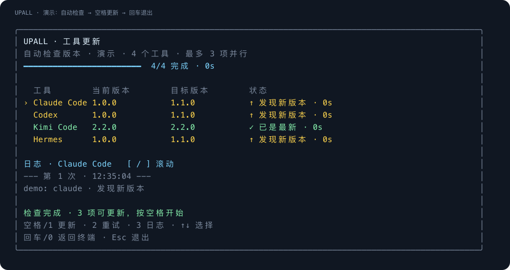

# UPALL

[简体中文](README.zh-CN.md) · [Contributing](CONTRIBUTING.md) · [Security](SECURITY.md)

Discover installed AI CLIs, check their versions, and update only when you choose.

**Check automatically → Space to update → Enter to exit.**

UPALL has a Chinese-first terminal UI, handles full-width number keys, shows per-tool logs, and adapts to narrow terminals. It uses Python's standard library at runtime.

It is an extracted module from a larger private workspace. This repository owns reusable behavior; the host project owns its configuration, shortcuts, private records and pinned dependency version. See [module integration](docs/module-integration.md) before adopting it into a larger project.

## Status

Version 0.1.0 is an early macOS release. The UI and integration tests run on macOS; other POSIX environments are experimental. Native Windows is not supported. There are no claims of universal package-manager support.

## Try it

Requires Python 3.11+.

Run directly from a checkout without installing:

~~~sh
git clone https://github.com/Ming-Sir-69/upall.git
cd upall
python3 tools/upall --demo
~~~

Install an isolated command using [uv](https://docs.astral.sh/uv/guides/tools/):

~~~sh
uv tool install git+https://github.com/Ming-Sir-69/upall.git
upall
~~~

To remove the commands, run uv tool uninstall upall-cli. To update UPALL itself, run uv tool upgrade upall-cli. UPALL does not update itself in the tool dashboard.

## Controls

| Key | Action |
|---|---|
| Space / 1 / U | Update tools with an available update |
| Enter / 0 / Esc / Q / X | Exit after the current batch finishes |
| 2 / R | Retry failed tools |
| 3 / L | Toggle the selected tool's log |
| Up / Down, J / K, Tab | Select a tool |
| [ / ] | Scroll the log |
| Ctrl-C | Stop this batch and its child process groups |

Full-width ０１２３ and the full-width space are supported. Update keys pressed during a running batch are not queued. Number-key hints keep the same mapping after completion.

An IME may consume a key while composing text or selecting a candidate. PTY tests validate the input that reaches the terminal, not every IME.

## Commands

~~~sh
upall                 # Discover installed CLIs and check; wait for Space
upall claude codex    # Limit the batch to these tools
upall --list          # Local inventory, including missing tools
upall --all           # Include missing candidates; skip, never install them
upall --json          # Final report; check only and exit
upall --plain         # Plain output; check only and exit
upall --retry         # Recheck failures from the previous batch
upall --update        # Explicitly check AND update, for unattended use
upall --demo          # Simulated UI; no real updater is invoked
~~~

The upcheck command is a compatibility alias for the same check-first flow. Redirected output, TERM=dumb, JSON and plain mode finish without waiting for a key. A failed update or check returns exit code 1; interrupted batches return 130; invocation/state errors return 2.

## Detection and updates

The known catalog includes Claude Code, Codex, Kimi Code, Hermes, Gemini CLI, Grok Build, OpenCode, OpenClaw, Pi, MiniMax Code, and Claude Desktop.

- Missing tools stay missing. This is an updater, not an automatic installer.
- npm and Homebrew installations use the detected package and manager prefix. A command under a Homebrew bin directory can still belong to npm.
- Known native/script installations use the corresponding official updater or installer.
- Unknown or project-local installations require manual handling. Desktop applications are inventory-only.
- Installation success is followed by a fresh version check.
- Checks run concurrently, with at most three workers. Installs sharing an npm prefix or Homebrew are serialized.

See [the support matrix](docs/adapters.md) for adapter boundaries. Tests use fake tools; a fixture passing does not prove every real installation variant works.

## State and privacy

State defaults to $XDG_STATE_HOME/upall, or ~/.local/state/upall. UPALL uses owner-only directories. Updates/checks use latest/, inventories use inventory/, and demonstrations use demo/latest/. Inventory does not replace the previous update report.

UPALL_LOG_ROOT overrides the state root. UPALL_SEARCH_PATH limits discovery to an explicit search path. NO_COLOR disables color. The tool does not read your API keys, sign-in stores, or conversation history. Reports and logs contain local paths and tool output; redact them before sharing.

Official updates execute third-party software, and an npm update may execute that package's lifecycle scripts. These commands run only after Space/1 or an explicit --update. Review the installation source and use your own account; UPALL never adds sudo.

## Development

~~~sh
python3 -m venv .venv
.venv/bin/python -m pip install -e .
.venv/bin/python -m unittest discover -s tests -v
~~~

[Architecture and decisions](docs/development.md) explain the module boundaries and the test policy. [Roadmap](docs/roadmap.md) lists unimplemented directions. See [CHANGELOG](CHANGELOG.md) for released behavior.

GitHub Actions is intentionally disabled for this repository. Checks and package validation run locally; the repository has no Pages deployment, Packages publication, or hosted build service configured.

## Credits and license

Interaction ideas were informed by [Topgrade](https://github.com/topgrade-rs/topgrade), [Gum](https://github.com/charmbracelet/gum), [Bubbles](https://github.com/charmbracelet/bubbles), and [Rich](https://github.com/Textualize/rich). Installation-provenance research included [CC Switch](https://github.com/farion1231/cc-switch). UPALL's implementation is original; it does not embed their source.

[MIT](LICENSE).

