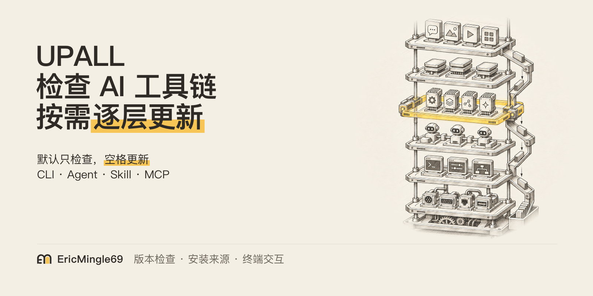
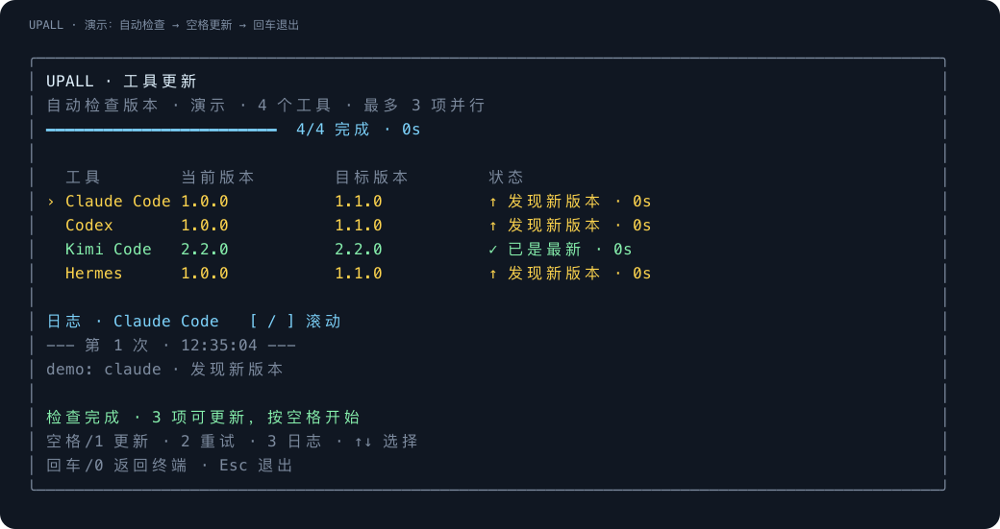

<picture>
  <source media="(prefers-color-scheme: dark)" srcset="readme-assets/cover-zh-dark.png">
  
</picture>

<a href="docs/adapters.md">适配器</a> · <a href="docs/development.md">开发</a> · <a href="CONTRIBUTING.md">贡献</a> · <a href="https://github.com/Ming-Sir-69">作者主页</a>

<b>简体中文</b> · <a href="README.en.md">English</a>

# UPALL · AI 工具链检查与按需更新

本项目检测已安装的 AI CLI、Agent 工具和维护应用，检查版本，并在明确操作后更新受支持的安装。开启监测后，主表列出各宿主已安装的 MCP 与 Skill。中文优先的终端界面在运行时只依赖 Python 标准库。

## 主要功能

- 自动检查；空格/1 更新有新版的项目，回车/0 退出。
- 保留检测到的安装来源与包管理器前缀；缺少的工具保持未安装。
- 提供同屏日志、窄终端适配和全角按键。
- MCP 只比较 npx 缓存版本与 npm registry 最新版，不安装、不改配置。
- Skill 按指纹识别；仅 Kimi WebBridge 的复制副本可在确认更新后对齐：按空格更新“多宿主副本不一致”的一行，或在 WebBridge 升级成功后同步。软链不改动，其他 Skill 只识别和展示。

## 快速开始

需要 Python 3.11 及以上。可直接从检出目录运行，无需安装：

~~~sh
git clone https://github.com/Ming-Sir-69/upall.git
cd upall
python3 tools/upall --demo
~~~

使用 uv 安装到独立工具环境。[[2]](#参考文献)

~~~sh
uv tool install git+https://github.com/Ming-Sir-69/upall.git
upall
~~~

更新 UPALL 本身用 `uv tool upgrade upall-cli`；卸载用 `uv tool uninstall upall-cli`。工具面板不更新 UPALL 自身。

## 用法

| 按键 | 功能 |
|---|---|
| 空格 / 1 / U | 更新有新版的工具 |
| 回车 / 0 / Esc / Q / X | 当前任务结束后退出；设置页内先返回主界面 |
| 2 / R | 重试失败项；无失败则刷新全部检查，含 MCP/Skill |
| 3 / L | 显示或隐藏所选工具日志 |
| 4 / S | 打开设置，切换监测类型；变更后立即重建主表并重检 |
| ↑↓、J/K、Tab | 选择工具，或设置页内的监测类型 |
| [ / ] | 滚动日志 |
| Ctrl-C | 停止本任务及其子进程组 |

支持全角 ０１２３４ 和全角空格。运行中按更新键不排队升级；任务完成后数字提示仍保持相同映射。输入法候选窗口可能先处理按键，PTY 测试只验证到达终端的输入，不能覆盖所有输入法。

命令与报告

~~~sh
upall                 # 发现已安装工具并检查，等待空格更新
upall claude codex    # 只处理指定工具
upall agent           # 只处理一个分组：cli、agent、app、host；也支持 -g
upall --list          # 本地清单，含缺少的候选；不联网
upall --all           # 展示缺少的候选并跳过，不安装
upall --json          # 最终 JSON；默认只检查并退出
upall --plain         # 纯文本；默认只检查并退出
upall --retry         # 重查上轮失败项
upall --update        # 显式检查并更新，供无人值守调用
upall --demo          # 模拟界面，不执行真实更新
~~~

`upcheck` 是同一检查优先流程的兼容入口。重定向输出、`TERM=dumb`、JSON 和纯文本模式结束后不等待按键。检查或更新失败返回 1，中断返回 130，调用或状态错误返回 2。

`upall --monitor runtime,skill,mcp` 按监测类型过滤，与显示分组独立。默认开启 runtime、Skill、MCP，关闭 plugin。设置保存到 `~/.config/upall/monitors.json`。见[纵向层说明](docs/ai-vertical-layers.md)。

## 设计与原理

已知目录包含 Claude Code、Codex、Kimi Code、Hermes、Gemini CLI、Grok Build、OpenCode、OpenClaw、Pi、MiniMax Code、Cursor Agent（AI 编程工具）；KimiCU、Kimi WebBridge、iPhone Use、Agent Desktop（Agent 插件与技能）；Mole、CC Switch（效率与维护）。自维护项目可作为本机项目接入；工具会报告本地修改是否已被上游收录，见[本地修改与上游](docs/local-modifications.md)。

- npm 与 Homebrew 使用实际检测到的包及前缀；Homebrew bin 目录中的命令仍可能属于 npm。npm 先尝试直连，再回退继承的代理环境。
- 大文件优先使用已安装的 aria2c 进行八连接下载，失败后使用干净的 curl 回退。Claude 原生更新保留渠道与目标版本，使用官方清单及可用的 zstd 包，安装前校验哈希。
- 已知原生或脚本安装调用对应的官方更新器；未知或项目内安装需手动处理。
- 安装成功后重新检查版本。
- 版本检查最多四个并发任务；子进程由 Python subprocess 管理。[[1]](#参考文献) 同一 npm 前缀或 Homebrew 的安装串行执行。

[适配器说明](docs/adapters.md)列出支持边界。测试使用伪工具；用例通过不代表所有真实安装方式都已验证。

状态默认放在 `$XDG_STATE_HOME/upall` 或 `~/.local/state/upall`，遵循 XDG 状态目录约定。[[3]](#参考文献) 目录仅当前用户可访问。检查与更新写入 `latest/`，安装清单写入 `inventory/`，演示写入 `demo/latest/`；清单不覆盖前次更新报告。每次运行追加到 `history.jsonl`。任务网络记录包括线路、下载器、尝试次序、耗时、字节数、速度和失败原因。

`UPALL_LOG_ROOT` 覆盖状态根目录，`UPALL_SEARCH_PATH` 限定发现路径，便于隔离测试；`NO_COLOR` 禁用颜色。本工具不读取 API 密钥、登录凭据或会话历史。日志和报告包含本机路径与工具输出，分享前需脱敏。

官方更新会执行第三方软件，npm 更新可能执行包的生命周期脚本。这些命令仅在按空格/1 或传入 `--update` 后运行；应核对安装来源并使用自己的账户，UPALL 不添加 sudo。

本仓库维护通用实现；接入项目负责配置、快捷入口、私有记录和固定依赖版本。见[模块集成](docs/module-integration.md)和[规范与实践对照](docs/standards.md)。

## 局限

当前 0.x 版本主要验证 macOS；其他 POSIX 环境仍属实验范围，原生 Windows 不支持。未声称覆盖全部包管理器。

MCP 过期时按空格只提示手动处理，不安装包、不改写宿主固定版本配置。通用插件适配仍为占位。终端演示使用模拟数据；隔离测试不能证明每种真实安装方式均兼容。

## 开发

~~~sh
python3 -m venv .venv
.venv/bin/python -m pip install -e .
.venv/bin/python -m unittest discover -s tests -v
~~~

[架构与决策](docs/development.md)说明模块边界与测试政策；[扩展方向](docs/roadmap.md)列出未实现内容；[变更记录](CHANGELOG.md)记录已发布行为。[安全边界](SECURITY.md)说明更新执行与数据处理的约束。

仓库约定使用本地验证，不添加计量服务。未配置 GitHub Actions 工作流；检查和安装包验证在本地执行，未配置 Pages、Packages 或托管构建服务。发布前用 `uv build` 构建，在干净虚拟环境安装 wheel，并执行 `upall --version` 和 `upall --demo --json`。

## 致谢

交互参考了 [Topgrade](https://github.com/topgrade-rs/topgrade)、[Gum](https://github.com/charmbracelet/gum)、[Bubbles](https://github.com/charmbracelet/bubbles) 和 [Rich](https://github.com/Textualize/rich)；安装来源调研参考了 [CC Switch](https://github.com/farion1231/cc-switch)。实现为原创，未嵌入这些项目的源码。Python 与受支持厂商的更新机制提供运行基础。

封面插画由图像生成模型生成，经本项目处理。

## 参考文献

1. Python Software Foundation. Python 3.11 documentation: subprocess — Subprocess management. https://docs.python.org/3.11/library/subprocess.html
2. Astral. uv documentation: Using tools. https://docs.astral.sh/uv/guides/tools/
3. freedesktop.org. XDG Base Directory Specification: Environment variables. https://specifications.freedesktop.org/basedir/latest/

## 仓库结构

| 路径 | 用途 |
|---|---|
| `src/upall/` | 发现、适配器、执行、终端界面与层级监测 |
| `tests/` | 隔离伪工具与 PTY 测试 |
| `tools/upall` | 源码运行入口 |
| `docs/` | 架构、适配器、集成与安全边界 |
| `readme-assets/` | 中英亮暗封面 |
| `assets/` | 终端演示 |
| `pyproject.toml` | 包元数据与命令入口 |

---

文档维护：**✦ EricMingle69** · [Ming-Sir-69](https://github.com/Ming-Sir-69)

许可：[MIT](LICENSE)。
